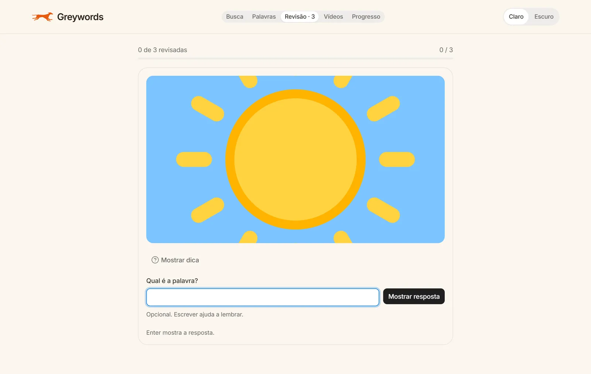
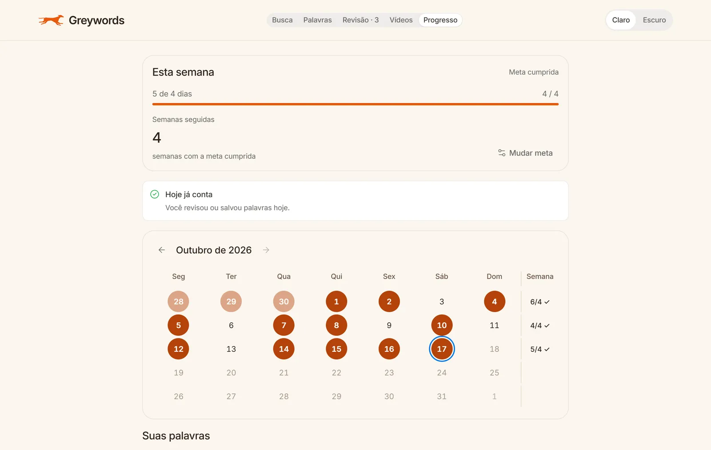
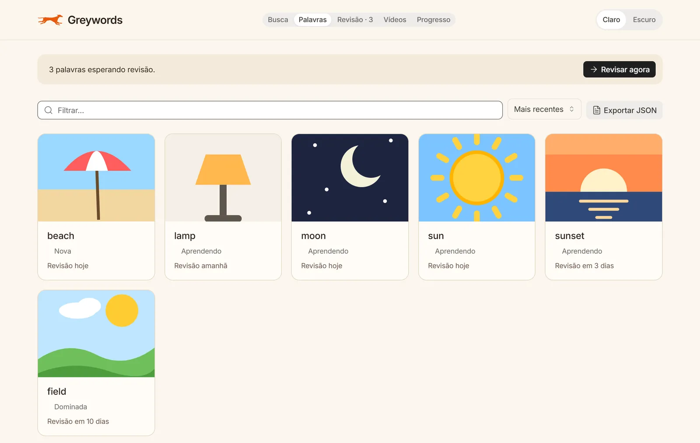

# Greywords

**Vocabulário em inglês pela imagem, não pela tradução.** Você busca uma palavra, escolhe as fotos que mais lembram ela e revisa no dia certo, com repetição espaçada.

### 👉 [greywords.greywords.workers.dev](https://greywords.greywords.workers.dev)

Grátis, sem cadastro e sem anúncios. Suas palavras ficam só no seu navegador.

| Revisão | Progresso | Palavras |
| --- | --- | --- |
|  |  |  |

## Por que pela imagem

Quem aprende "sun" ligando a palavra ao português ("sol") faz um desvio a cada vez que lê. O Greywords liga a palavra direto à ideia: a frente do flashcard são as fotos que **você** escolheu, e a tradução fica escondida até você pedir. A revisão espaçada (SM-2, a mesma família do Anki) traz cada palavra de volta pouco antes de você esquecer.

## O que dá para fazer

- **Buscar uma palavra:** fotos do Unsplash, definição em inglês, pronúncia e até 5 frases reais com a palavra (Tatoeba), com a tradução escondida. "Refinar" troca as fotos e "Esconder" tira uma que não serve.
- **Palavras sem imagem**, como "however": as frases aparecem no lugar das fotos, e na revisão você completa a frase com a palavra que falta.
- **Revisar:** o cartão vira ao revelar; palpite opcional, notas de 1 a 4 pelo teclado.
- **Progresso:** meta semanal, calendário dos dias estudados, semanas seguidas e taxa de acerto.
- **Exportar** tudo em JSON.

## O ângulo de dados: imagens certeiras de 45,6% para 96,1%

A primeira versão buscava fotos em bancos abertos (Openverse e Wikimedia), e muitas não tinham nada a ver com a palavra. Para medir em vez de achar, montei um teste: **20 palavras × 9 imagens**, em 6 grupos (substantivos concretos, verbos, adjetivos, palavras ambíguas, abstratas e gramaticais), marcadas como certeiras ou não **sem ver o título**.

| Fonte | Certeiras | Impróprias |
| --- | --- | --- |
| Openverse + Wikimedia (antes) | 82/180 (45,6%) | 0 |
| Unsplash, com a definição como contexto (depois) | **173/180 (96,1%)** | 0 |

A busca também passou a usar o significado: espera a definição por até 2 s e monta a consulta pela classe gramatical ("person studying" para o verbo "study"). Os números por grupo e o método estão em [specs/003-imagens-certeiras/medicao.md](specs/003-imagens-certeiras/medicao.md).

## Como foi feito

- **React 19 + Vite**, JavaScript, sem backend próprio: os dados ficam no `localStorage`.
- **Design system [BEDS](https://github.com/meunomeebero/beds)** para os controles. Layout, paleta quente (tokens `--gw-*` com contraste AA conferido por teste) e títulos em Fraunces são do app.
- **Efeitos** com [Motion](https://motion.dev) e CSS próprio, reescritos a partir de componentes MIT do [21st.dev](https://21st.dev). Todos respeitam "reduzir movimento" e pausam fora da tela.
- **Revisão espaçada** SM-2 com ajustes no estilo do Anki.
- **Testes automáticos** da lógica com `node:test` (220+ testes).
- **Hospedagem grátis no Cloudflare:** o site é um Worker com arquivos estáticos, e um segundo Worker guarda a chave do Unsplash, para que ela nunca chegue ao navegador. Esse segundo Worker também mantém as buscas por 24 h no Workers KV.

Serviços usados (todos gratuitos, com tempo limite e reserva):

| Dado | Principal | Reserva |
| --- | --- | --- |
| Fotos | Unsplash (pelo Worker) | Openverse, depois Wikimedia Commons |
| Definição e pronúncia | Free Dictionary (dictionaryapi.dev) | Wiktionary; voz do navegador |
| Tradução | MyMemory | — |
| Frases de exemplo | Tatoeba | exemplos do próprio dicionário |
| Vídeos | YouTube (canal oficial do TED) | — |

## Em construção

- **Vídeos do TED por nicho e nível.** A aba está pronta: o nível de cada talk é estimado pela transcrição (palavras por minuto e % de palavras fora das 2.809 mais comuns da lista NGSL). Falta a curadoria manual das transcrições, porque os Termos do TED proíbem coletá-las por programa. Até lá, a aba mostra "Vídeos em preparação".
- **Dados mais seguros:** importar o backup, app instalável no celular e lembrete de estudo.

## Rodar no seu computador

```bash
npm install
npm run dev          # http://localhost:5173  (#/ landing · #/app app)
npm test             # testes de lógica
npm run check:ui     # contrato do design system
npm run build
```

As fotos do Unsplash no modo de desenvolvimento pedem um arquivo `.env.local` com `UNSPLASH_ACCESS_KEY=...` (uma Access Key grátis em [unsplash.com/developers](https://unsplash.com/developers)). Sem ele, o app usa o Openverse.

Publicar, com a conta do Cloudflare configurada:

```bash
npm run deploy:site     # build + site
npm run deploy:images   # Worker das fotos (a chave fica em: npx wrangler secret put UNSPLASH_ACCESS_KEY)
```

## Como o projeto é organizado

Cada funcionalidade passou por requisitos, design e tarefas antes do código, com os critérios conferidos no navegador ao final. Os documentos estão em [specs/](specs/README.md).

## Créditos

- Fotos: [Unsplash](https://unsplash.com/?utm_source=greywords&utm_medium=referral), com crédito ao fotógrafo em cada foto.
- Frases: [Tatoeba](https://tatoeba.org), licenças CC BY 2.0 FR e CC0, com autor e link de cada frase.
- Vídeos: [TED](https://www.ted.com), licença CC BY–NC–ND 4.0. As transcrições não são publicadas.
- Lista de palavras comuns: [New General Service List](https://www.newgeneralservicelist.com) (Browne, Culligan e Phillips), CC BY-SA 4.0.
- Efeitos visuais, fontes e bibliotecas: [CREDITS.md](CREDITS.md).
